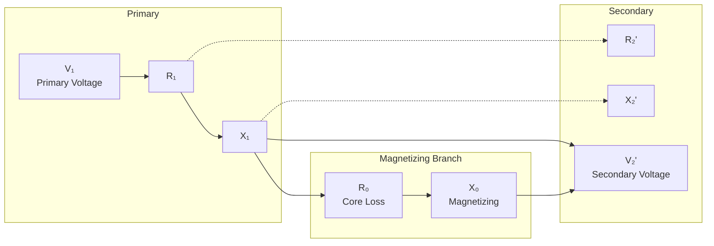
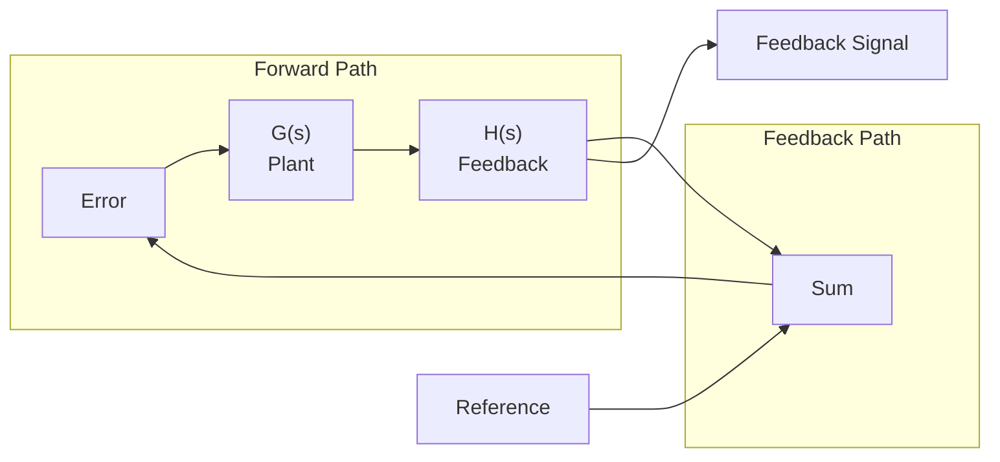
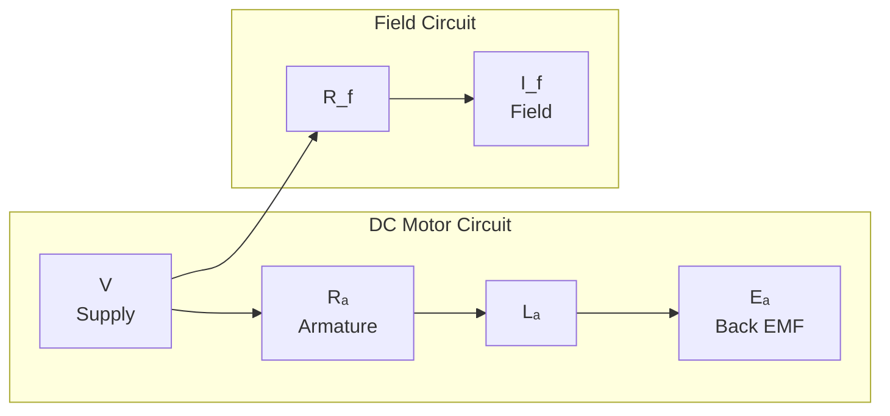

# Electrical Diagrams Skill

Use this skill when explaining electrical concepts that need visual diagrams.

## ASCII Art (Simple, works everywhere)

Best for: Transformer equivalent circuits, simple circuits, connection diagrams

### Transformer Equivalent Circuit (referred to primary)

```
        PRIMARY                    SECONDARY
    ────────|↦|─────────────────|↦|───────
            │                    │
           R₁                   R₂'
          X₁                    X₂'
            │                    │
    ────────┼────────────────────┼───────
            │         ┌───┐      │
            └─────────| R₀ ├──────┘
                     │ X₀ │
                     └───┘
```

### Open Circuit Test (LV side test)

```
    ─────────────────────────────────
         AC Source    Voltmeter   Ammeter
             |           |           |
             |           |           |
           (N₁)       (V₁)        (I₀)
             |           |           |
             └───────────┴───────────┘
                    [OC]

    Measured: V₁, I₀, P₀ (iron losses)
```

### Short Circuit Test (HV side test)

```
    ─────────────────────────────────
         AC Source    Voltmeter   Ammeter
             |           |           |
             |           |           |
           (N₁)       (Vsc)       (Isc)
             │           │           │
             └───────||───────||─────┘
                      SHORT
                    [SC]

    Measured: Vsc, Isc, Psc (copper losses)
```

### Star (Y) Connection

```
           Phase A
              │
              │
         ┌────●────┐
        ╱     │     ╲
       ╱      │      ╲
    Phase   Neutral   Phase
    B              C
     │             │
     └──────●──────┘
           (Neutral point)
```

### Delta (Δ) Connection

```
       Phase A ◄───────► Phase B
          │               ▲
          │              ╱
          ▼             ╱
       Phase C ────────►
```

### DC Machine

```
    ┌──────────────────────────────────────┐
    │          ARMATURE (rotor)            │
    │   ┌────────────────────────────┐    │
    │   │  Conductors on surface    │    │
    │   │  (carrying current out)   │    │
    │   └────────────────────────────┘    │
    │                                      │
    │   ←── Rotation (mechanical input)  │
    │                                      │
    │  N    S    N    S    N    S        │
    │  ↑ Poles on stator (field) ↑        │
    └──────────────────────────────────────┘
              │
              │ Commutator + Brushes
              ▼
         DC Output
```

### Three Phase Transformer Connections

```
STAR (Y):                        DELTA (Δ):
       Phase A                        Phase A
          │                              │
          │                        ┌─────┼─────┐
     ┌────●────┐                   │     │     │
    ╱     │     ╲                  │     │     │
   ╱      │      ╲             ◄──┼─────┼─────┼──►
Phase   Neutral   Phase           │     │     │
B              C                   └─────┼─────┘
 │             │                        Phase B
 └──────●──────┘
       (Neutral point)
```

### Inductor & Capacitor Reactance vs Frequency

```
  X_L = ωL                    X_C = 1/(ωC)

  X_L                          X_C
   │                            │
   │                           │←──Infinite at ω=0
   │                            │
   │                            │
  ─┼──────────────→            ─┼──────────────→
   │ ω=0                       │ ω→∞
   │                           │
```

### RLC Series Resonance

```
      ──────/\/\/\/\────o────o─────
                      L       C
                     ───     ───
      Source               │
   V ~                      └──── Resonance frequency ω = 1/√(LC)
```

---

## Mermaid Diagrams (Complex, interactive)

Use `mermaid` code blocks for:
- Block diagrams
- Flowcharts
- Control system diagrams

### Example: Transformer Equivalent Circuit



### Example: Block Diagram (Closed Loop Control)



### Example: DC Motor Control



---

## Waveform Drawing (ASCII)

### Sinusoidal AC Wave

```
  V
   ↑
 325│            ****           ****
   │          **    **       **    **
   │         *        **    **        *
   │        *           ****           *
   │       *                            
   │      *                              
    ─────┼──────────────────────────────→ t
   -325│      **            **
       │        ****    ****
       │            ****
```

### Three Phase Waveforms

```
  Phase A:    /\    /\    /\    /\    /\
            /    \/    \/    \/    \/    \
  Phase B:      /\    /\    /\    /\    /\
              /    \/    \/    \/    \/    \
  Phase C:        /\    /\    /\    /\    /\
                /    \/    \/    \/    \/    \
                    ↑
              120° apart
```

### Full Wave Rectifier Output

```
  Vdc
   ↑
  Vm│████   ████   ████   ████   ████
   │   ██ ██   ██ ██   ██ ██   ██
   │    ████     ████     ████
  0├──────────────────────────────────→ t
   │
   └─ Ripple voltage
```

---

## Tips for Creating Diagrams

1. **Keep it simple** - ASCII art works best for simple circuits
2. **Use alignment** - spaces matter for ASCII art
3. **Label clearly** - add component values when relevant
4. **Mermaid for complex** - use for block diagrams and flowcharts
5. **Match the viewer's renderer** - not all markdown viewers support Mermaid
